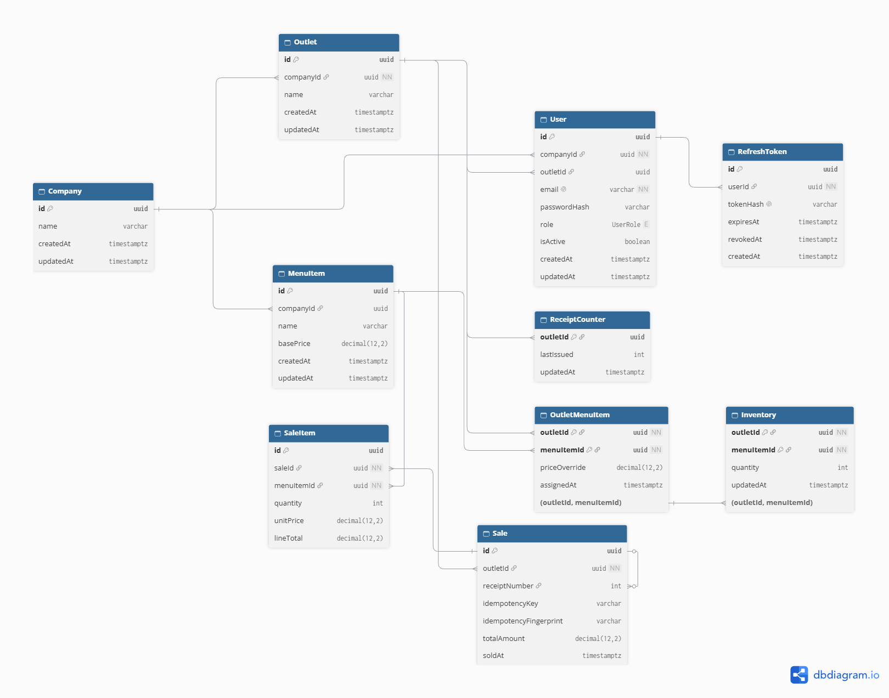

# F&B Outlet Management System

Centralized HQ and outlet management system for master menus, outlet-specific pricing, inventory, sales transactions, and reporting.

## Overview

```text
One company -> Multiple outlets -> HQ assigns menu items -> Outlets create sales -> HQ views reports
```

HQ manages the master menu and outlet assignments. Each outlet accesses its assigned menu, maintains local inventory, processes sales, and deducts stock safely.

## Features

- Create, edit, and delete master menu items (items with sales history are kept)
- Assign and unassign menu items per outlet
- Override menu prices per outlet
- Create HQ and outlet users, and reassign outlet users to another company outlet
- Retrieve only the menu items assigned to an outlet
- Track inventory separately for each outlet
- Create multi-item sales and deduct inventory in one transaction
- Prevent negative stock
- Generate sequential receipt numbers per outlet
- Preserve receipt correctness during concurrent requests
- Report outlet revenue (optional date range) and top five selling items
- Idempotent offline-sale synchronization
- Company isolation, HQ and outlet roles, rotating refresh tokens
- React UI for HQ management and the outlet POS

## Technology Stack

- **Backend:** Node.js 20, Express 5, TypeScript, Prisma, Zod
- **Frontend:** React 19, Vite
- **Database:** PostgreSQL 16
- **Testing:** Vitest, Supertest
- **Deployment:** Docker, Docker Compose, GitHub Actions CI

## Project Structure

```text
.
├── backend/
│   ├── prisma/
│   │   ├── schema.prisma       # data model
│   │   ├── migrations/         # SQL migrations with CHECK constraints and indexes
│   │   └── seed.ts             # demo company, outlets, menu, logins
│   ├── src/
│   │   ├── app.ts              # middleware chain and routers
│   │   ├── http/               # auth, validation, error, rate-limit middleware
│   │   ├── database/           # Prisma client and test reset
│   │   └── modules/            # auth, organization, menu, inventory, sales, reporting, offline-sync, shared
│   └── tests/                  # unit and integration suites
├── frontend/src/               # React SPA
├── database/init/              # creates the test database in Docker
├── docs/
│   ├── architecture.md         # design, scaling, microservices, offline POS/KDS
│   ├── erd.md                  # entity relationship diagram
│   ├── testing.md              # test plan and coverage
│   ├── workspace.dsl           # Structurizr C4 model source
│   └── c4/                     # exported C4 diagram images and keys
├── .github/workflows/ci.yml
├── docker-compose.yml
├── Dockerfile                  # API image
└── README.md
```

## Prerequisites

- Node.js 20+
- PostgreSQL 15+
- Docker and Docker Compose (recommended)

## Getting Started

### Option A: Docker (recommended)

1. Create a `.env` file in the project root. Set a database password and two long, different random secrets:

   ```env
   POSTGRES_PASSWORD=replace-with-a-strong-database-password
   JWT_ACCESS_SECRET=replace-with-a-long-random-value
   JWT_REFRESH_SECRET=replace-with-a-different-long-random-value
   FRONTEND_ORIGIN=http://localhost:3105
   VITE_API_URL=http://localhost:5105/api
   ```

2. Start everything:

   ```bash
   docker compose up -d --build
   ```

3. Open the app at <http://localhost:3105>. The API is published on port `5105`; check <http://localhost:5105/health> for process health or <http://localhost:5105/ready> to check database readiness. API routes are under `/api`; the `/api` root is not a web page.

   `VITE_API_URL` is baked into the frontend image at build time. If you change it, rebuild the frontend with `docker compose up -d --build frontend`. The database volume preserves its original credentials; changing `POSTGRES_PASSWORD` alone does not change a database that has already been initialized.

4. Optional: load the demo data. This **wipes** the development database first.

   ```bash
   docker compose exec api npx prisma db seed
   ```

### Option B: Run locally

1. Start PostgreSQL, for example with `docker compose up db`.
2. Configure and start the API:

   ```bash
   cd backend
   cp .env.example .env        # then set DATABASE_URL and both JWT secrets
   npm install
   npm run db:deploy
   npm run db:seed             # optional demo data; wipes the database
   npm run dev
   ```

3. In a second terminal, start the frontend:

   ```bash
   cd frontend
   npm install
   npm run dev
   ```

   Set `FRONTEND_ORIGIN` in `backend/.env` to the Vite URL (usually `http://localhost:5173`) so the browser is allowed to call the API.

### Environment variables

| Variable | Required | Default | Purpose |
|---|---|---|---|
| `DATABASE_URL` | yes | none (Docker Compose builds it) | PostgreSQL connection string |
| `JWT_ACCESS_SECRET` | yes in production | dev-only fallback | Signs 15-minute access tokens |
| `JWT_REFRESH_SECRET` | yes in production | dev-only fallback | Signs 30-day refresh tokens. Must differ from the access secret |
| `FRONTEND_ORIGIN` | yes for browser access | Compose: `https://techzu.kossti.com` | The only origin CORS allows. Set to `http://localhost:3105` for local Docker use |
| `PORT` | no | `5000` | API port inside the container |
| `API_PORT` | no | `5105` | Host port mapped to the API container |
| `FRONTEND_PORT` | no | `3105` | Host port mapped to the frontend container |
| `VITE_API_URL` | Docker build time | Compose: `/api` | API base URL baked into the frontend build. For local Docker use, set `http://localhost:5105/api` |
| `POSTGRES_DB`, `POSTGRES_USER` | Docker only | `fb_outlet`, `fb_user` | Database name and user |
| `POSTGRES_PASSWORD` | Docker only | none | Required database password; choose a strong local value |

The API refuses to start in production without both JWT secrets. A template for local API development is in [`backend/.env.example`](backend/.env.example). Root and backend `.env` files are git-ignored.

### Demo logins (after seeding)

| Role | Email | Password |
|---|---|---|
| HQ | `hq@demo.local` | `demo-password-123` |
| Outlet (Downtown) | `downtown@demo.local` | `demo-password-123` |

These are for local use only. Never seed a shared environment.

### Common workflows

- **Assign a menu:** Sign in as HQ, create items under **Menu → Catalog**, then open **Menu → Outlet assignment**, choose an outlet and item, and assign it. An optional outlet price override is available there.
- **Manage an outlet's stock:** Choose the outlet in HQ's **Working outlet** selector and use **Operations → Inventory**, or sign in as that outlet user and open **Menu & stock**. Stock is stored per outlet and item; updating it sets that outlet's new total quantity.
- **Move an outlet user:** Sign in as HQ and open **Users** in the sidebar. In **Team directory**, click **Change outlet** on an outlet-user row, select an outlet, and save. This changes the outlet association, not the user's role or password.
- **View company reports:** Sign in as HQ and open **Reports** in the sidebar. The report shows revenue and the top five selling items for each outlet. Filter by one outlet or all outlets, and optionally choose a date range. Outlet users still have a report for their own outlet.

## API Endpoints

Base URL: `/api`. All routes except `/auth/*` need `Authorization: Bearer <accessToken>`.

| Method | Endpoint | Role | Description |
|---|---|---|---|
| `POST` | `/auth/register` | public | Create a company and its first HQ user |
| `POST` | `/auth/login` | public | Get access and refresh tokens |
| `POST` | `/auth/refresh` | public | Rotate a refresh token |
| `GET` | `/companies/:companyId/outlets` | HQ | List outlets |
| `POST` | `/companies/:companyId/outlets` | HQ | Create an outlet |
| `POST` | `/companies/:companyId/users` | HQ | Create an HQ or outlet user |
| `PUT` | `/companies/:companyId/users/:userId/outlet` | HQ | Reassign an outlet user to an outlet in the same company |
| `GET` | `/menu-items` | HQ | List the company master menu |
| `POST` | `/menu-items` | HQ | Create a master menu item |
| `PUT` | `/menu-items/:menuItemId` | HQ | Update name and/or base price |
| `DELETE` | `/menu-items/:menuItemId` | HQ | Delete an unassigned, unsold item |
| `POST` | `/outlets/:outletId/menu-items` | HQ | Assign a menu item to an outlet |
| `DELETE` | `/outlets/:outletId/menu-items/:menuItemId` | HQ | Unassign an item (removes its stock) |
| `PUT` | `/outlets/:outletId/menu-items/:menuItemId/price` | HQ | Override the outlet price |
| `GET` | `/outlets/:outletId/menu` | HQ, outlet | Assigned menu with effective prices |
| `GET` | `/outlets/:outletId/inventory` | HQ, outlet | Stock levels |
| `POST` | `/outlets/:outletId/inventory` | HQ, outlet | Create a stock record |
| `PUT` | `/outlets/:outletId/inventory/:menuItemId` | HQ, outlet | Set stock |
| `POST` | `/outlets/:outletId/sales` | HQ, outlet | Create a sale |
| `POST` | `/outlets/:outletId/sync/sales` | HQ, outlet | Idempotent sale (requires `Idempotency-Key`) |
| `GET` | `/reports/company?outletId=&from=&to=` | HQ | Revenue and top five items per company outlet, with optional outlet/date filters |
| `GET` | `/reports/outlets/:outletId/revenue?from=&to=` | HQ, outlet | Single-outlet revenue, optional date range |
| `GET` | `/reports/outlets/:outletId/top-items?limit=5` | HQ, outlet | Top-selling items |

The company report includes outlets with no sales in the selected date range (zero revenue and an empty top-items list). It is restricted to HQ users and only returns data from their company.

Health checks: `GET /health` (process up) and `GET /ready` (database reachable).

Outlet users can only access their own outlet. HQ users can only access outlets and menu items in their own company. The outlet reassignment route only changes outlet users and only accepts outlets belonging to the user's company.

### Request and response examples

**Log in**

```bash
curl -X POST http://localhost:5105/api/auth/login \
  -H 'Content-Type: application/json' \
  -d '{"email":"hq@demo.local","password":"demo-password-123"}'
```

```json
{
  "user": { "id": "…", "email": "hq@demo.local", "role": "HQ", "companyId": "…", "outletId": null },
  "tokens": { "accessToken": "…", "refreshToken": "…", "tokenType": "Bearer", "expiresIn": 900 }
}
```

**Create a menu item and assign it with an outlet price**

```bash
curl -X POST http://localhost:5105/api/menu-items -H "Authorization: Bearer $TOKEN" \
  -H 'Content-Type: application/json' -d '{"name":"Iced Latte","basePrice":180}'
# 201 {"id":"<itemId>","companyId":"…","name":"Iced Latte","basePrice":180,…}

curl -X POST http://localhost:5105/api/outlets/$OUTLET/menu-items -H "Authorization: Bearer $TOKEN" \
  -H 'Content-Type: application/json' -d '{"menuItemId":"<itemId>"}'
# 201

curl -X PUT http://localhost:5105/api/outlets/$OUTLET/menu-items/<itemId>/price -H "Authorization: Bearer $TOKEN" \
  -H 'Content-Type: application/json' -d '{"price":195}'
# 200 {"outletId":"…","menuItemId":"<itemId>","priceOverride":195,…}
```

**Get the outlet menu**

```json
GET /api/outlets/:outletId/menu
{ "items": [ { "id": "…", "name": "Iced Latte", "price": 195 } ] }
```

**Create a sale (offline-safe)**

```bash
curl -X POST http://localhost:5105/api/outlets/$OUTLET/sync/sales -H "Authorization: Bearer $TOKEN" \
  -H 'Idempotency-Key: pos-1-000123' -H 'Content-Type: application/json' \
  -d '{"items":[{"menuItemId":"<itemId>","quantity":2}]}'
```

```json
{
  "id": "…",
  "receiptNumber": 42,
  "totalAmount": 390,
  "items": [ { "id": "…", "menuItemId": "<itemId>", "quantity": 2, "unitPrice": 195, "lineTotal": 390 } ]
}
```

The first request returns `201`. Retrying with the same key and body returns `200` with the same sale, and stock is not deducted twice.

**Reports**

```json
GET /api/reports/outlets/:outletId/revenue?from=2026-11-01&to=2026-11-30
{ "totalRevenue": 390, "from": "2026-11-01", "to": "2026-11-30" }

GET /api/reports/outlets/:outletId/top-items?limit=5
{ "items": [ { "menuItemId": "…", "name": "Iced Latte", "quantity": 2 } ] }

GET /api/reports/company?from=2026-11-01&to=2026-11-30
{
  "outlets": [
    {
      "outletId": "…",
      "outletName": "Downtown",
      "totalRevenue": 390,
      "topItems": [ { "menuItemId": "…", "name": "Iced Latte", "quantity": 2 } ]
    }
  ],
  "from": "2026-11-01",
  "to": "2026-11-30"
}
```

Add `outletId=<uuid>` to the company report query to filter it to one outlet. Date-only `to` values include the entire day.

**Errors** all share one shape:

```json
{ "error": { "code": "INSUFFICIENT_STOCK", "message": "Insufficient inventory for this sale" } }
```

| Status | Example codes |
|---|---|
| `400` | `VALIDATION_ERROR` (with `details`), `IDEMPOTENCY_KEY_REQUIRED` |
| `401` | `AUTHENTICATION_REQUIRED`, `INVALID_TOKEN`, `INVALID_CREDENTIALS` |
| `403` | `FORBIDDEN` |
| `404` | `NOT_FOUND` |
| `409` | `CONFLICT`, `INSUFFICIENT_STOCK`, `MENU_ITEM_NOT_ASSIGNED`, `MENU_ITEM_IN_USE`, `IDEMPOTENCY_KEY_REUSED` |
| `429` | `RATE_LIMITED` |

## Database Schema

- **Company:** owns outlets, menu items, and users
- **Outlet:** an F&B location
- **MenuItem:** a master item in the company catalog
- **OutletMenuItem:** an outlet assignment with an optional outlet price
- **Inventory:** stock per outlet and assigned item
- **ReceiptCounter:** the last receipt number issued per outlet
- **Sale / SaleItem:** a transaction and its lines, with the price at the time of sale
- **User / RefreshToken:** local accounts, roles, and rotating sessions

See the diagram in [`docs/erd.md`](docs/erd.md).

## Architecture, ERD, and C4

### System architecture

```text
HQ browser ─┐                         ┌─> PostgreSQL 16
            ├─> React SPA (nginx) ──> Express API (Node 20)
POS browser ┘                         └─> future: cache, queue, read replica
```

The application is a **modular monolith**: one deployable API organized around authentication, organization, menu, inventory, sales, reporting, and offline synchronization. Requests pass through validation and authorization middleware, then module services and Prisma, into PostgreSQL. PostgreSQL is the source of truth.

### Entity relationship diagram

The diagram summarizes the main database entities and relationships. `OutletMenuItem` connects an outlet to an assigned company menu item; inventory is attached to that assignment, so stock is tracked independently for each outlet and item.



The complete schema, including constraints and key rules, is in [`docs/erd.md`](docs/erd.md) and [`backend/prisma/schema.prisma`](backend/prisma/schema.prisma).

### C4 architecture diagrams

The diagrams below show the system context, runtime containers, and API components. They describe the current modular-monolith design; the offline queue is a design direction, not a local queue implementation.

#### System context


#### Containers


#### API components


The Structurizr source is [`docs/workspace.dsl`](docs/workspace.dsl), with diagram keys in [`docs/c4/`](docs/c4). The C4 model and source are also documented in [`docs/architecture.md`](docs/architecture.md).

### Design decisions

| Decision | Rationale |
|---|---|
| Modular monolith before microservices | A single deployable service is easier to operate at the current scale; module boundaries leave room to extract services if an actual need emerges. |
| One database transaction per sale | Sale creation, stock deduction, receipt numbering, and idempotency commit together or roll back together. |
| Receipt counter per outlet | Row-level updates serialize receipt allocation for one outlet without making outlets share a counter. |
| Database constraints | Foreign keys, unique constraints, and checks enforce critical invariants even if application logic is bypassed. |
| Sale-line price snapshot | Later menu price changes do not rewrite historical receipts or reports. |
| Idempotency key for synchronized sales | Retrying a sale after a timeout does not create a duplicate sale or deduct stock twice. |
| Stateless API authentication | Any API instance can serve a request, enabling horizontal scaling without session affinity. |

## Scaling plan: 10 outlets and 100,000 transactions per month

This is a forward-looking plan, not a claim that the current deployment has been load-tested at this volume. One hundred thousand transactions per month averages roughly 3,300 per day. Design for short peak periods (for example, lunch rushes), monitor real traffic, and scale based on measured saturation rather than outlet count alone.

### Database scaling strategies

- **Keep PostgreSQL as the transactional source of truth.** Start with a suitably sized managed PostgreSQL instance or a well-maintained single primary. At this volume, a sharded or multi-primary database is not the first step.
- **Preserve the current constraints and indexes.** Indexes on outlet and sale date, sale-item menu item, and unique per-outlet receipt and idempotency keys support tenant-scoped lookups, reporting, and correctness.
- **Keep the write transaction short.** Sale creation performs only database work in its transaction. The per-outlet receipt counter and conditional stock decrement protect concurrency while avoiding cross-outlet receipt contention.
- **Manage connections.** Monitor connection count, query latency, locks, and pool wait time. Use connection pooling; add PgBouncer if multiple API instances would otherwise exhaust PostgreSQL connections.
- **Scale vertically first and protect recovery.** Increase database CPU, memory, or I/O when metrics show a bottleneck. Automate backups, test restores, and enable point-in-time recovery before relying on the system operationally.
- **Partition only when data size justifies it.** If sales tables grow to tens of millions of rows and retention queries or maintenance become costly, evaluate time-based partitioning and archive old partitions. Partitioning adds operational complexity and is not required by the target volume alone.

### Reporting performance

- The HQ company report aggregates revenue and ranks sold items for each selected company outlet. The `(outletId, soldAt)` index supports outlet/date filtering; top-selling items group sale lines for that outlet.
- Keep reporting queries bounded and measure execution plans and latency against production-like data. Do not send expensive report aggregation to the primary without monitoring its impact on checkout writes.
- If live reports begin competing with sales, add a read replica for reporting and accept/document its replication lag.
- If history grows enough that indexed live aggregation is no longer responsive, build daily outlet and item summaries asynchronously. Feed summaries from a durable outbox or equivalent replayable event stream, make processing idempotent, and reconcile summaries against the source sales.
- The company dashboard returns the selected outlets in one scoped report request. As data grows, keep the query bounded with date filters and move read load to a replica or summary table if measurement shows that is needed.

### Infrastructure considerations

- Keep the API stateless and containerized. Add a second or more API instances behind a load balancer when measured request load, availability requirements, or deployments warrant it.
- Put the database on a private network, configure connection limits and timeouts, and use `/health` and `/ready` appropriately for process and dependency checks.
- Move the in-memory rate limiter to a shared store such as Redis before running multiple API instances, so limits are consistent across instances.
- Add structured logs with request IDs, metrics for latency/errors/throughput and database saturation, alerting, centralized log retention, and tested backup/restore procedures.
- Use rolling or otherwise health-checked deployments, and verify database migrations are compatible with the running application version before rollout.

### Architectural evolution

Keep the modular monolith while it meets requirements. First improve observability, connection management, and reporting read paths; these steps address likely bottlenecks without distributed-system overhead. If independent scaling or team ownership later requires service extraction, use module boundaries:

1. Add repository interfaces where they provide a useful separation between business logic and persistence.
2. Publish durable domain events through a transactional outbox so database writes and event publication cannot silently diverge.
3. Extract reporting first into a read-optimized service/model because it is a read path and can be rebuilt from source events.
4. Extract identity, catalog, inventory, sales, or offline synchronization only when there is a measured scaling or organizational need.
5. Keep sale and inventory updates in one database transaction until they are separated. Afterward, use stock reservations, idempotent commands, and a saga with compensation; do not rely on a distributed database transaction.

See [`docs/architecture.md`](docs/architecture.md) for additional detail on concurrency, tenancy, service boundaries, and future offline POS/KDS operation.

## Validation and Error Handling

- Request bodies, route parameters, and query parameters are validated with Zod.
- Sales are rejected when stock is unavailable.
- PostgreSQL enforces foreign keys, unique constraints, and `CHECK` constraints (positive prices, non-negative stock, positive quantities).
- Central error middleware returns one consistent error shape and never exposes stack traces.

## Security

### In place

- **Passwords:** hashed with scrypt and a random salt, compared in constant time, minimum 12 characters.
- **Tokens:** HS256 JWTs. Access tokens last 15 minutes. Refresh tokens last 30 days, are stored hashed, and are rotated on every use, so a used refresh token is rejected.
- **Authorization:** `HQ` and `OUTLET` roles. Every outlet route checks that the outlet belongs to the caller's company, and outlet users can only reach their own outlet.
- **Tenant isolation:** another company's records are reported as `404 Not Found`, so their existence does not leak.
- **Input validation:** Zod schemas on every body, path parameter and query string.
- **CORS:** only `FRONTEND_ORIGIN` is allowed.
- **Rate limiting:** 100 requests per minute per IP on `/api`, returning `429` with `Retry-After`.
- **Secrets:** read from the environment and never committed. Production startup fails without them.
- **SQL injection:** prevented by Prisma's parameterized queries.

### Planned hardening

These are known gaps, listed by priority:

1. A stricter login limit and account lockout after repeated failures.
2. An atomic refresh-token revoke. When a used token is presented again, revoke all of that user's sessions.
3. A `POST /auth/logout` endpoint that revokes the refresh token.
4. Security headers (`helmet`: HSTS, CSP, nosniff, frame-deny).
5. Move the refresh token from `localStorage` to an `httpOnly`, `Secure`, `SameSite=Strict` cookie.
6. Run the API container as a non-root user, and stop publishing the database port outside Docker.
7. Audit logging for logins, user and role changes, and price changes, plus `npm audit` in CI.

## Resilience

- **Health checks:** `GET /health` shows the process is up. `GET /ready` checks the database, so a load balancer can stop sending traffic to an instance that can't reach it.
- **Safe retries:** sales sent through `/sync/sales` are idempotent, so clients can retry freely.
- **Rate limiting:** the limiter is in memory today. Behind a load balancer it moves to Redis with `trust proxy` enabled, and it should count per user or outlet rather than per IP, because the tills in one outlet often share one IP.
- **Circuit breaker:** not added yet, on purpose. The API calls no external services, and its only dependency, PostgreSQL, has no fallback (a sale can't be saved without it). Database pool and statement timeouts are the right protection for now. A circuit breaker (for example `opossum`) will wrap the first external integration, such as payments or SMS, with a fallback for each call.

## Testing

Run from `backend/` with PostgreSQL running (`docker compose up db` creates the `fb_outlet_test` database):

```bash
npm test
npm run test:coverage
```

The unit and integration suites cover menu assignment and pricing, outlet-specific inventory, concurrent sales and receipts, reports, offline retries, constraints, and company and role isolation using real bearer tokens. Run them with PostgreSQL available as described in [`docs/testing.md`](docs/testing.md). CI runs the suite on every push.

## Deployment

- **Live application:** _not deployed yet_
- **API documentation:** see [API Endpoints](#api-endpoints) above
- **Repository:** <https://github.com/monijaman/TechzuIchicode>

## Offline POS Mode Strategy

The POS caches its menu and stock snapshot, writes each sale to a durable local queue with an idempotency key, and talks to the KDS over the local network while the internet is down. When it reconnects, it replays the queue through `/sync/sales`, which is implemented and tested to be safe on retry. See [`docs/architecture.md`](docs/architecture.md#7-offline-pos-and-kds-strategy).

## Assumptions and Known Limitations

- Each user belongs to one company. Outlet users belong to exactly one outlet.
- A single currency is used, and amounts are stored as decimals.
- Online sales are rejected when stock is short. Offline sales that would make stock negative are planned to be accepted and flagged instead (see [offline strategy](docs/architecture.md#7-offline-pos-and-kds-strategy)).
- The offline queue and KDS link are designed but not built. The server side (`/sync/sales`) is implemented and tested.
- Anyone can call `/auth/register` to create a company. A real deployment would require an invite or email verification.
- Reports aggregate live data. Daily summary tables are planned for when history grows.

## Assessment Requirements

- [ ] Deployed instance
- [x] GitHub repository
- [x] Clean commits and proper folder structure
- [x] Layered architecture, validation, error middleware, and environment configuration
- [x] PostgreSQL constraints and appropriate indexes
- [x] Dockerfile and Docker Compose
- [x] README, ERD, and architecture documentation (including a C4 model)
- [x] Authentication, role-based access, and tenant isolation
- [x] Rate limiting and health/readiness checks
- [x] Automated unit and integration tests running in CI
- [x] Scaling strategy for 10 outlets and 100,000 monthly transactions
- [x] Microservices evolution strategy
- [x] Offline POS and KDS synchronization strategy

## License

This project was created as a technical assessment.
