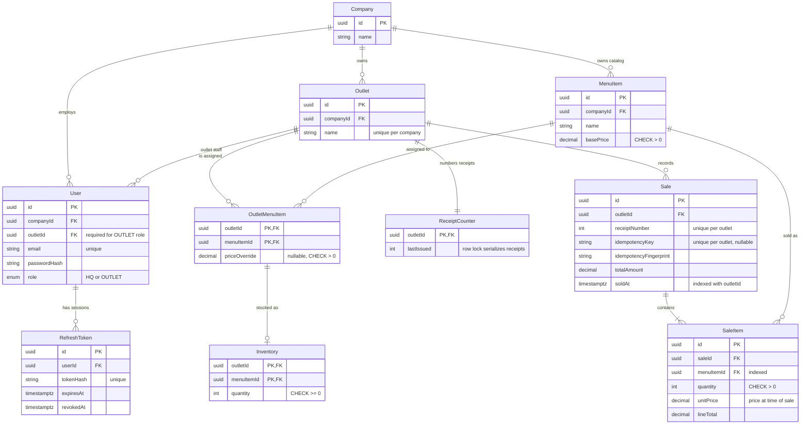

# Entity Relationship Diagram

Generated from [`backend/prisma/schema.prisma`](../backend/prisma/schema.prisma). GitHub renders the Mermaid diagram below.

## Key rules

- `Inventory` references the `OutletMenuItem` assignment, so an outlet can only stock items it was assigned. Unassigning an item removes its stock row.
- `SaleItem` stores `unitPrice` at the time of sale, so later price changes never rewrite history. Sold menu items cannot be deleted (`ON DELETE RESTRICT`).
- `ReceiptCounter` is incremented inside the sale transaction. The row lock gives each outlet gap-free, sequential receipt numbers under concurrent requests.
